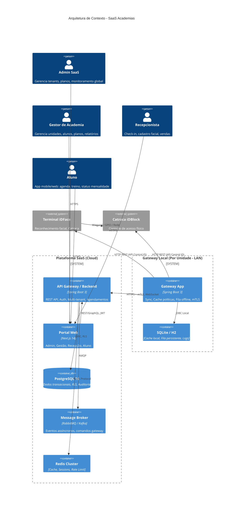

# Arquitetura Geral do Sistema

## Visão Geral

Sistema SaaS multi-tenant para gerenciamento de academias com reconhecimento facial via equipamentos Control iD (iDFace + iDBlock).

---

## Decisões Arquiteturais Principais

| Decisão | Escolha | Justificativa |
|---------|---------|---------------|
| **Backend** | Monólito modular (Spring Boot 3.x, Java 21) | Simplicidade operacional para escala pequena/média; módulos isolados permitem extração futura |
| **Frontend** | Next.js 14+ (App Router), TypeScript, MVVM | SSR/SSG para SEO, React Server Components, tipagem forte |
| **Multi-tenancy** | Shared database, shared schema + `tenant_id` em todas as tabelas | Menor overhead operacional; RLS no PostgreSQL garante isolamento |
| **Gateway Local** | Aplicação Java independente (Spring Boot) por unidade | Hardware dedicado (Raspberry Pi/mini PC); operação offline nativa |
| **Comunicação SaaS ↔ Gateway** | HTTPS + mTLS + WebSocket (eventos) / REST (comandos) | Segurança em trânsito; WebSocket para push de comandos em tempo real |
| **Banco de Dados** | PostgreSQL 16 + Flyway | ACID, JSONB, RLS nativo, extensões úteis (uuid-ossp, pgcrypto) |
| **Autenticação** | JWT (access + refresh) + Spring Security | Stateless, escalável, padrão de mercado |
| **ORM** | JPA/Hibernate + Querydsl | Produtividade + type-safe queries complexas |

---

## Diagrama de Componentes (Mermaid)



---

## Estrutura de Módulos do Backend (Monólito Modular)

```
src/main/java/com/gymsaas/
├── gymsaas-core/           # Kernel: domain events, value objects, exceptions, multi-tenant context
├── gymsaas-tenant/         # Tenant, SaaS Plan, Subscription, Branch
├── gymsaas-user/           # User, Role, Permission, RBAC, UserTenant
├── gymsaas-student/        # Student, Plan, StudentPlan, Payment, Check-in
├── gymsaas-access/         # AccessRule, AccessSchedule, AccessLog, BiometricProfile
├── gymsaas-device/         # Gateway, Device, Turnstile, DeviceCredential, DeviceCommand, DeviceEvent
├── gymsaas-controlid/      # Adapter Control iD (isolado do domínio)
├── gymsaas-gateway/        # Cliente SDK para Gateway Local (DTOs, contracts)
├── gymsaas-audit/          # AuditLog, LGPD compliance
├── gymsaas-notification/   # Email, Push, WhatsApp, In-app
└── gymsaas-web/            # Controllers, DTOs, Security config, OpenAPI
```

### Princípios Clean Architecture por Módulo

```
gymsaas-<module>/
├── domain/
│   ├── model/           # Entities, Value Objects, Domain Events
│   ├── repository/      # Repository Interfaces (Ports)
│   └── service/         # Domain Services (regras puras)
├── application/
│   ├── usecase/         # Use Cases / Application Services
│   ├── dto/             # Input/Output DTOs
│   └── mapper/          # Domain ↔ DTO
├── infrastructure/
│   ├── persistence/     # JPA Entities, Repositories Impl, Flyway migrations
│   ├── adapter/         # External adapters (Control iD, Email, etc)
│   └── config/          # Module-specific Spring config
└── interface/
    ├── rest/            # Controllers (apenas adaptação HTTP)
    └── event/           # Event Publishers/Listeners
```

---

## Comunicação entre Componentes

### SaaS Backend ↔ Gateway Local

| Fluxo | Protocolo | Padrão | Descrição |
|-------|-----------|--------|-----------|
| **Heartbeat / Status** | HTTPS + mTLS | Polling (30s) | Gateway reporta status, logs pendentes, saúde |
| **Sync Completo** | HTTPS + mTLS | Agendado / Sob demanda | Push de usuários, regras, horários, credenciais |
| **Comando Imediato** | WebSocket (sobre mTLS) | Push | Abrir catraca, msg display, reiniciar equipamento |
| **Eventos (Acesso, Alarme)** | WebSocket / HTTPS | Async | Gateway envia access_logs, alarm_logs, catra_events |
| **Firmware/Config** | HTTPS + mTLS | Sob demanda | Atualização de firmware, parâmetros de rede |

### Formato de Contrato (Exemplo)

```json
// Sync Request (SaaS → Gateway)
{
  "syncId": "uuid",
  "tenantId": "uuid",
  "branchId": "uuid",
  "timestamp": "2026-11-12T10:00:00Z",
  "payload": {
    "users": [...],
    "accessRules": [...],
    "timeZones": [...],
    "devices": [...],
    "credentials": [...]
  },
  "checksum": "sha256"
}

// Event (Gateway → SaaS)
{
  "eventId": "uuid",
  "eventType": "ACCESS_GRANTED",
  "deviceSerial": "IDF-12345",
  "timestamp": "2026-11-12T10:00:05Z",
  "payload": {
    "userId": 12345,
    "userRegistration": "ALU-001",
    "portalId": 1,
    "confidence": 1650,
    "faceMask": false
  }
}
```

---

## Estratégia Multi-Tenant

### Isolamento de Dados

- **Shared Schema**: Todas as tabelas possuem coluna `tenant_id UUID NOT NULL`
- **Row Level Security (RLS)**: Políticas no PostgreSQL garantem que `WHERE tenant_id = current_setting('app.current_tenant')`
- **Contexto de Tenant**: `TenantContextHolder` (ThreadLocal / ContextPropagator para WebFlux) injeta `tenant_id` em:
  - JPA/Hibernate `@FilterDef` + `@Filter`
  - Querydsl predicates automáticos
  - Auditoria automática

### Provisionamento (Manual/Admin)

1. Admin SaaS cria `Tenant` + `SaasPlan` + `TenantSubscription`
2. Cria `Branch` (unidade) + `Gateway` (registro do hardware)
3. Gera credenciais mTLS para o Gateway (certificado cliente)
4. Envia link de ativação para instalador de campo
5. Gateway faz bootstrap: valida certificado, baixa configuração inicial, registra dispositivos

### Limites por Plano SaaS

| Recurso | Starter | Professional | Enterprise |
|---------|---------|--------------|------------|
| Unidades | 1 | 5 | Ilimitado |
| Alunos/Unidade | 1.000 | 5.000 | 20.000+ |
| Terminais | 2 | 10 | 50 |
| Gateways | 1 | 5 | 20 |
| Retenção Logs | 90 dias | 1 ano | 5 anos |
| API Rate Limit | 100/min | 1.000/min | 10.000/min |

---

## Frontend: MVVM com Next.js 14 (App Router)

```
src/
├── app/
│   ├── (auth)/login/page.tsx
│   ├── (dashboard)/
│   │   ├── admin/          # Admin SaaS
│   │   ├── manager/        # Gestor Academia
│   │   ├── reception/      # Recepção
│   │   └── student/        # Aluno (PWA)
│   └── api/                # Route Handlers (BFF se necessário)
├── components/
│   ├── ui/                 # Design System (shadcn/ui + Tailwind)
│   ├── forms/              # Form components reutilizáveis
│   └── charts/             # Recharts wrappers
├── lib/
│   ├── api/                # Client SDK (fetch + Zod validation)
│   ├── auth/               # Auth context, token refresh
│   ├── store/              # Zustand stores (UI state)
│   └── utils/
├── viewmodels/             # ViewModels por feature (MVVM)
│   ├── student/
│   ├── access/
│   └── device/
└── types/                  # Zod schemas + TS types (shared com backend via OpenAPI)
```

### ViewModel Pattern

```typescript
// viewmodels/student/StudentListViewModel.ts
export class StudentListViewModel {
  private students = signal<Student[]>([]);
  private loading = signal(false);
  private filters = signal<StudentFilters>({});

  constructor(private api: ApiClient, private store: StudentStore) {}

  async load() {
    this.loading.set(true);
    try {
      const data = await this.api.students.list(this.filters());
      this.students.set(data);
      this.store.setStudents(data);
    } finally {
      this.loading.set(false);
    }
  }

  // Computed signals para UI
  readonly activeStudents = computed(() => 
    this.students().filter(s => s.status === 'ACTIVE')
  );
}
```

---

## Riscos Identificados

| Risco | Probabilidade | Impacto | Mitigação |
|-------|---------------|---------|-----------|
| Limite de templates faciais no iDFace (ex: 3.000) | Alta | Alto | Modo Standalone (identificação local) + sync seletivo; Enterprise mode para > limite |
| Gateway offline por dias | Média | Alto | Fila local persistente (SQLite), replay automático, alerta no SaaS |
| Perda de biometria (LGPD) | Baixa | Crítico | Criptografia em repouso (AES-256), chave por tenant, purge automático por consentimento |
| Conflito de IDs entre equipamentos | Média | Médio | UUID global no SaaS; mapeamento `device_serial ↔ device_id` no gateway |
| Latência rede LAN instável | Média | Médio | Modo Pro (identificação local, autorização server) como default; timeout configurável |
| Firmware incompatível | Baixa | Alto | Matriz de compatibilidade documentada; validação no onboarding; OTA via gateway |

---

## Critérios de Aceite Fase 1

- [ ] Documento de arquitetura aprovado (este)
- [ ] Modelo ER validado com DBA
- [ ] Mapeamento Control iD completo (endpoints, objetos, limitações)
- [ ] ADRs registradas para decisões críticas
- [ ] Estrutura de pastas do monólito criada
- [ ] Docker Compose dev (PostgreSQL, Redis, RabbitMQ, Mailhog)
- [ ] Flyway baseline + primeira migration (schema multi-tenant + RLS)
- [ ] Spring Security + JWT + TenantContext funcionando
- [ ] Next.js scaffold + Design System + Auth flow
- [ ] Contratos SaaS ↔ Gateway definidos (OpenAPI/AsyncAPI)
- [ ] Checklist Fase 2 pronto