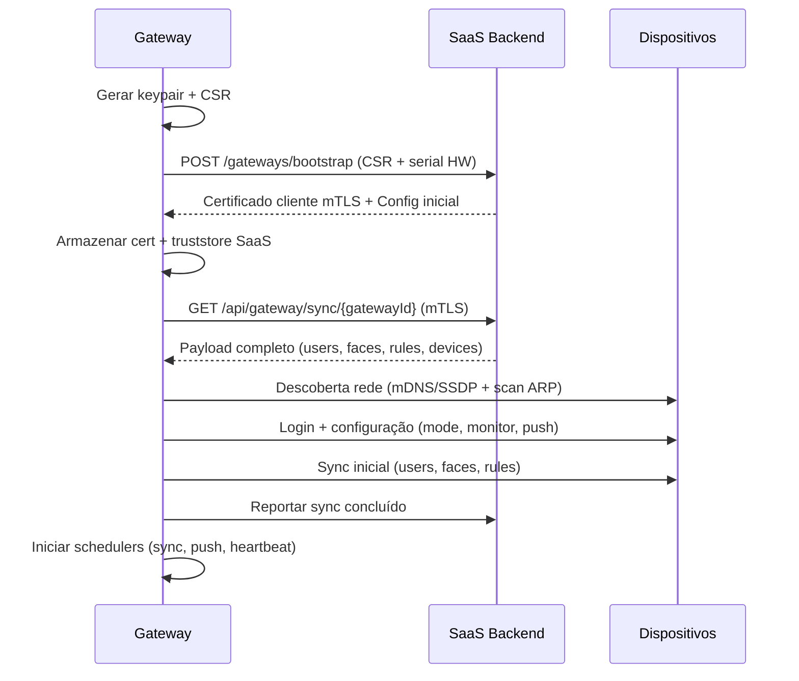
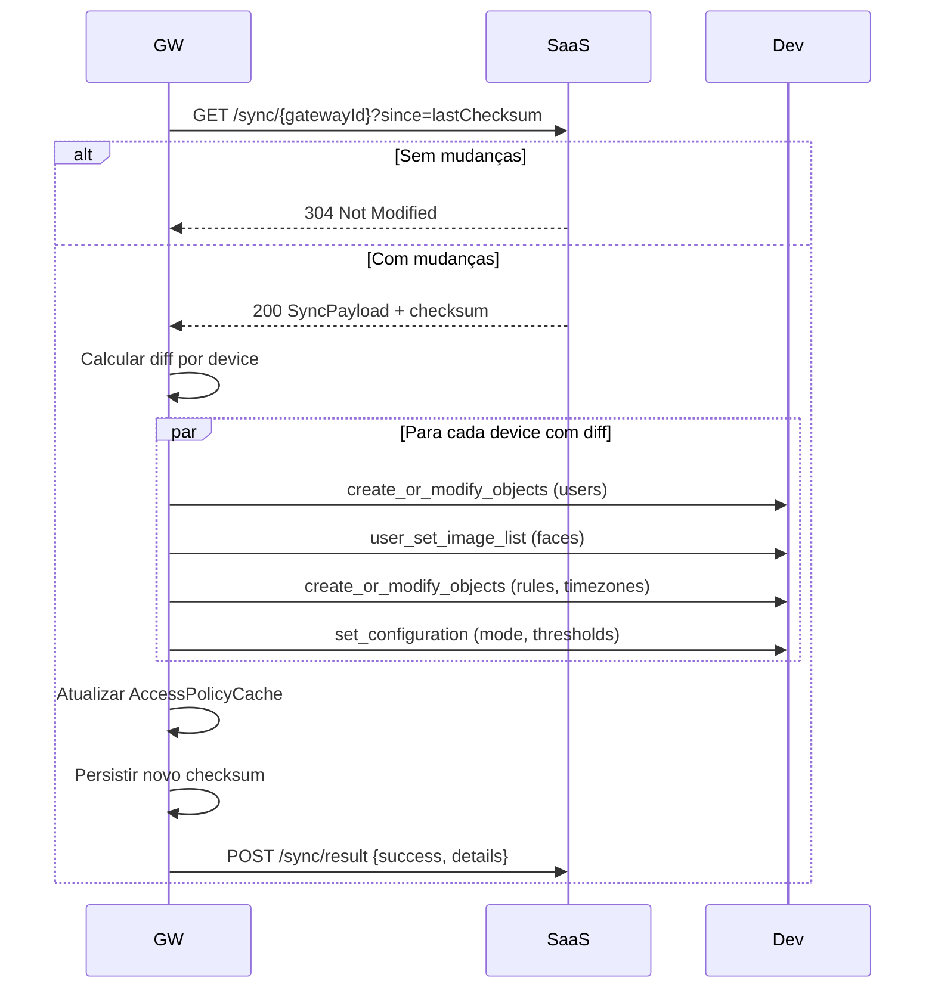
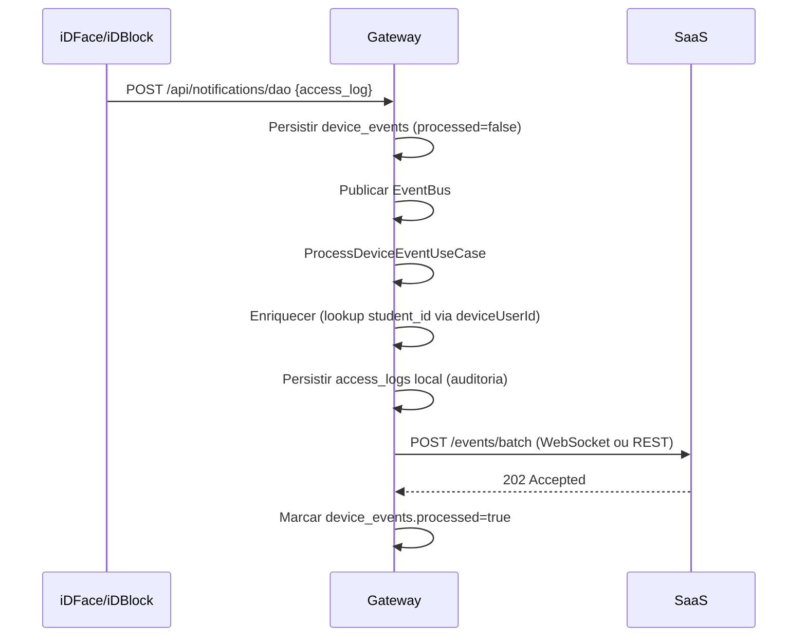
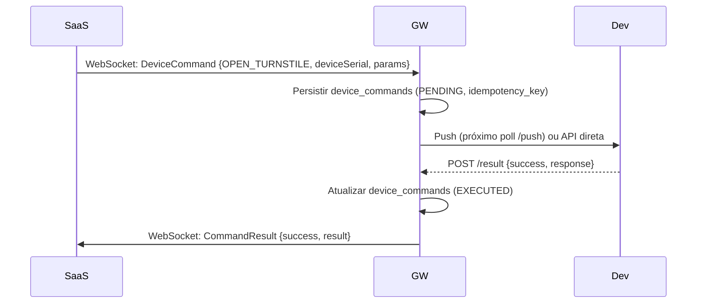
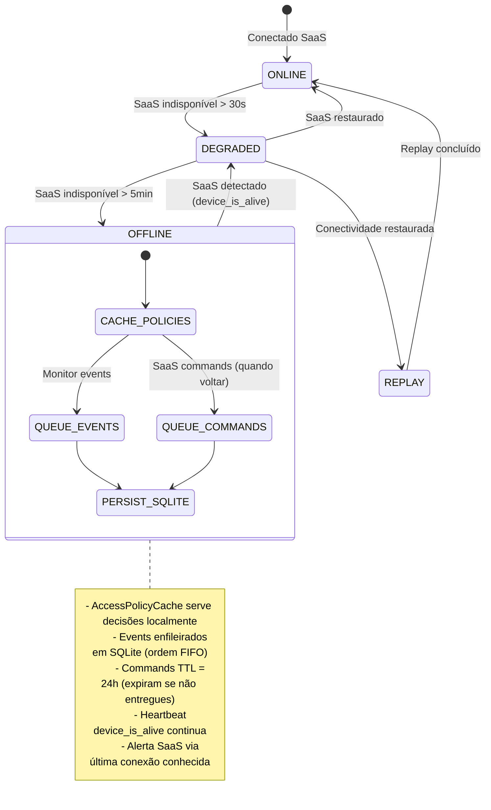

# Arquitetura do Gateway Local

## Visão Geral

Aplicação **Java 21 + Spring Boot 3.x** executada em hardware dedicado por unidade (Raspberry Pi 4/5, Mini PC Intel NUC, ou similar).
Responsável por toda comunicação LAN com equipamentos Control iD, sincronização com SaaS, cache de políticas e operação offline.

---

## Requisitos Funcionais

| ID | Requisito | Prioridade |
|----|-----------|------------|
| GW-01 | Comunicação HTTP/HTTPS com equipamentos Control iD (iDFace, iDBlock) | P0 |
| GW-02 | Sincronização bidirecional com SaaS (usuários, regras, faces, comandos) | P0 |
| GW-03 | Recebimento de eventos via Monitor (access_logs, alarm_logs, catra_events, door_state) | P0 |
| GW-04 | Envio de comandos via Push (polling) e API direta | P0 |
| GW-05 | Fila local persistente de eventos (SQLite/H2) com replay automático | P0 |
| GW-06 | Cache de políticas de acesso (regras, horários, usuários válidos) | P0 |
| GW-07 | Operação offline completa (até 7 dias sem conectividade SaaS) | P0 |
| GW-08 | Autenticação mTLS com SaaS + renovação automática de certificados | P0 |
| GW-09 | Monitoramento: saúde, métricas, logs estruturados, alertas | P0 |
| GW-10 | Prevenção de duplicidade (idempotency keys, deduplicação events) | P0 |
| GW-11 | Reprocessamento de eventos falhos (DLQ + retry exponencial) | P1 |
| GW-12 | Descoberta automática de equipamentos na rede (mDNS/SSDP) | P2 |
| GW-13 | Atualização de firmware OTA (staged, rollback) | P2 |

---

## Arquitetura Interna (Clean Architecture)

```
gateway-app/
├── domain/
│   ├── model/
│   │   ├── Device.java              # Aggregate root
│   │   ├── DeviceCommand.java       # Command aggregate
│   │   ├── DeviceEvent.java         # Event aggregate
│   │   ├── SyncState.java           # Value object
│   │   └── BiometricEnrollment.java
│   ├── repository/
│   │   ├── DeviceRepository.java
│   │   ├── CommandRepository.java
│   │   ├── EventRepository.java
│   │   └── SyncStateRepository.java
│   └── service/
│       ├── SyncOrchestrator.java    # Domain service
│       ├── AccessPolicyCache.java   # Domain service
│       └── DeviceCommunicator.java  # Domain service
├── application/
│   ├── usecase/
│   │   ├── SyncWithSaaSUseCase.java
│   │   ├── ProcessDeviceEventUseCase.java
│   │   ├── ExecuteCommandUseCase.java
│   │   └── EnrollBiometricUseCase.java
│   ├── dto/
│   └── mapper/
├── infrastructure/
│   ├── persistence/
│   │   ├── sqlite/                  # SQLite para fila + cache local
│   │   │   ├── SqliteDeviceRepository.java
│   │   │   └── SqliteEventStore.java
│   │   └── jpa/                     # H2 para configuração gateway
│   ├── adapter/
│   │   ├── controlid/
│   │   │   ├── ControlIdApiClient.java
│   │   │   ├── ControlIdMonitorServer.java  // HTTP server para Monitor
│   │   │   ├── ControlIdPushClient.java     // Polling /push
│   │   │   ├── ControlIdObjectMapper.java
│   │   │   └── model/              # DTOs Control iD
│   │   ├── saas/
│   │   │   ├── SaasApiClient.java  // mTLS + WebSocket
│   │   │   ├── SaasEventPublisher.java
│   │   │   └── dto/
│   │   └── hardware/
│   │       └── NetworkDiscovery.java
│   ├── config/
│   │   ├── SecurityConfig.java      // mTLS, certificates
│   │   ├── SchedulerConfig.java     // @Scheduled tasks
│   │   └── WebSocketConfig.java
│   └── monitoring/
│       ├── MetricsExporter.java     // Prometheus
│       └── HealthIndicators.java
└── interface/
    ├── rest/
    │   ├── MonitorController.java   // Endpoints Monitor
    │   ├── PushController.java      // Endpoint /push
    │   └── ManagementController.java // Health, config, debug
    └── cli/                         // Opcional: CLI admin local
```

---

## Componentes Principais

### 1. ControlIdApiClient

Cliente HTTP robusto para API REST dos equipamentos.

```java
@Component
public class ControlIdApiClient {
    private final HttpClient httpClient;
    private final SessionManager sessionManager;
    private final CircuitBreaker circuitBreaker;
    
    // Operações
    public CompletableFuture<LoginResponse> login(DeviceCredential cred);
    public CompletableFuture<SyncResult> syncUsers(Device device, List<UserDTO> users);
    public CompletableFuture<SyncResult> syncFaces(Device device, List<FaceDTO> faces);
    public CompletableFuture<SyncResult> syncAccessRules(Device device, List<AccessRuleDTO> rules);
    public CompletableFuture<CommandResult> sendCommand(Device device, DeviceCommand cmd);
    public CompletableFuture<List<AccessLog>> fetchAccessLogs(Device device, Instant since);
}
```

**Features**:
- Pool de conexões por device (HikariCP-style para HttpClient)
- Gerenciamento automático de sessão (login, keep-alive, renovação)
- Circuit Breaker (Resilience4j) por device
- Retry exponencial com jitter
- Request/Response logging (sanitizado)
- Métricas: latency, success rate, error rate por endpoint

### 2. ControlIdMonitorServer

Servidor HTTP embarcado (Undertow/Jetty) para receber eventos Monitor.

```java
@Component
public class ControlIdMonitorServer {
    // Endpoints expostos em :8080/api/notifications/*
    
    @PostMapping("/dao")
    public ResponseEntity<Void> handleDaoChanges(@RequestBody DaoChangesPayload payload);
    
    @PostMapping("/catra_event")
    public ResponseEntity<Void> handleCatraEvent(@RequestBody CatraEventPayload payload);
    
    @PostMapping("/operation_mode")
    public ResponseEntity<Void> handleOperationMode(@RequestBody OperationModePayload payload);
    
    @PostMapping("/device_is_alive")
    public ResponseEntity<Void> handleDeviceAlive(@RequestBody DeviceAlivePayload payload);
    
    @PostMapping("/door")
    public ResponseEntity<Void> handleDoorState(@RequestBody DoorStatePayload payload);
    
    @PostMapping("/secbox")
    public ResponseEntity<Void> handleSecboxState(@RequestBody SecboxStatePayload payload);
}
```

**Processamento**:
1. Valida assinatura/origem (IP allowlist + device_id)
2. Persiste em `device_events` (SQLite) com `processed=false`
3. Publica evento no `EventBus` interno (Spring ApplicationEvent)
4. Retorna 200 OK imediatamente (assíncrono)

### 3. ControlIdPushClient

Polling periódico do endpoint `/push` de cada device.

```java
@Component
@EnableScheduling
public class ControlIdPushClient {
    @Scheduled(fixedDelay = 5000) // configurável por device
    public void pollCommands() {
        for (Device device : onlineDevices) {
            try {
                PushResponse response = httpClient.get("/push?deviceId=...&uuid=...");
                if (response.hasCommands()) {
                    executeCommands(device, response.getCommands());
                }
            } catch (Exception e) {
                metrics.pushErrors.increment();
            }
        }
    }
}
```

**Execução de comandos**:
- Parse `transactions[]` ou comando único
- Executa via `ControlIdApiClient` (mesma sessão)
- Coleta resultados
- Envia `POST /result` com `transaction_results[]`

### 4. SyncOrchestrator

Coordena sincronização SaaS ↔ Device.

```java
@Service
public class SyncOrchestrator {
    public SyncResult fullSync(Gateway gateway) {
        // 1. Baixar sync do SaaS (GET /api/gateway/sync/{gatewayId})
        // 2. Calcular diff por device (hash do payload)
        // 3. Para cada device com diff:
        //    a. Sync users (create_or_modify_objects)
        //    b. Sync faces (user_set_image_list - prioridade ativos)
        //    c. Sync access_rules + time_zones
        //    d. Sync device config (mode, thresholds)
        // 4. Atualizar SyncState.timestamp + checksum
        // 5. Reportar resultado ao SaaS
    }
    
    public SyncResult incrementalSync(Gateway gateway, List<Device> dirtyDevices) {
        // Apenas devices marcados como dirty (comando enviado, evento processado)
    }
}
```

**Estratégia de Diff**:
- SaaS envia `checksum` SHA-256 do payload agregado por device
- Gateway compara com `last_synced_checksum` armazenado
- Se igual → skip (sem mudanças)
- Se diferente → sync incremental

### 5. AccessPolicyCache

Cache em memória + persistido para operação offline.

```java
@Component
public class AccessPolicyCache {
    // Estrutura otimizada para lookup O(1)
    private final Map<Long, UserPolicy> userPolicies = new ConcurrentHashMap<>(); // deviceUserId -> policy
    private final Map<Long, AccessRule> accessRules = new ConcurrentHashMap<>();
    private final Map<Long, TimeZone> timeZones = new ConcurrentHashMap<>();
    
    public AccessDecision evaluate(Device device, IdentificationEvent event) {
        // 1. Buscar userPolicy pelo deviceUserId
        // 2. Verificar validade (validFrom/validTo, status)
        // 3. Avaliar accessRules vinculadas (priority, timeZones)
        // 4. Retornar GRANT/DENY + actions + message
    }
    
    public void refreshFromSync(SyncPayload payload) {
        // Rebuild atômico (double-buffered)
    }
}
```

**Estrutura `UserPolicy`**:
```java
record UserPolicy(
    long deviceUserId,
    String registration,
    String name,
    Instant validFrom,
    Instant validTo,
    Set<Long> accessRuleIds,
    boolean active,
    boolean faceEnrolled,
    boolean cardEnrolled
) {}
```

### 6. EventStore (SQLite)

Persistência local de eventos e comandos.

```sql
-- device_events (eventos recebidos via Monitor)
CREATE TABLE device_events (
    id TEXT PRIMARY KEY,           -- UUID
    gateway_id TEXT NOT NULL,
    device_serial TEXT NOT NULL,
    event_type TEXT NOT NULL,      -- ACCESS_LOG, ALARM_LOG, CATRA_EVENT, etc
    event_subtype TEXT,
    payload_json TEXT NOT NULL,    -- JSON bruto
    processed INTEGER DEFAULT 0,   -- 0/1
    processing_error TEXT,
    received_at TEXT NOT NULL,     -- ISO8601
    occurred_at TEXT NOT NULL,
    created_at TEXT DEFAULT (datetime('now'))
);
CREATE INDEX idx_device_events_gateway_received ON device_events(gateway_id, received_at);
CREATE INDEX idx_device_events_device_type ON device_events(device_serial, event_type);
CREATE INDEX idx_device_events_unprocessed ON device_events(processed) WHERE processed = 0;

-- device_commands (comandos a enviar via Push/API)
CREATE TABLE device_commands (
    id TEXT PRIMARY KEY,
    gateway_id TEXT NOT NULL,
    device_serial TEXT NOT NULL,
    command_type TEXT NOT NULL,
    parameters_json TEXT NOT NULL,
    priority INTEGER DEFAULT 0,
    status TEXT DEFAULT 'PENDING', -- PENDING, SENT, ACKNOWLEDGED, EXECUTED, FAILED, EXPIRED
    idempotency_key TEXT UNIQUE,
    sent_at TEXT,
    acked_at TEXT,
    executed_at TEXT,
    result_json TEXT,
    error_message TEXT,
    expires_at TEXT,
    created_at TEXT DEFAULT (datetime('now')),
    updated_at TEXT DEFAULT (datetime('now'))
);
CREATE INDEX idx_commands_gateway_status ON device_commands(gateway_id, status);
CREATE INDEX idx_commands_idempotency ON device_commands(idempotency_key);

-- sync_state (controle de sincronismo)
CREATE TABLE sync_state (
    gateway_id TEXT PRIMARY KEY,
    device_serial TEXT NOT NULL,
    last_full_sync_at TEXT,
    last_incremental_sync_at TEXT,
    last_checksum TEXT,
    last_synced_at TEXT,
    status TEXT DEFAULT 'NEVER_SYNCED',
    error_message TEXT
);
```

### 7. SaasApiClient

Comunicação segura com backend SaaS.

```java
@Component
public class SaasApiClient {
    private final WebClient webClient; // mTLS configurado
    private final WebSocketClient wsClient;
    
    // REST
    public Mono<SyncPayload> fetchSync(String gatewayId);
    public Mono<Void> reportSyncResult(SyncResult result);
    public Mono<Void> publishEvents(List<DeviceEvent> events);
    public Mono<Void> reportCommandResult(CommandResult result);
    public Mono<Void> heartbeat(GatewayStatus status);
    
    // WebSocket (comandos imediatos)
    public void connect(String gatewayId);
    public void onCommandReceived(DeviceCommand cmd);
}
```

**mTLS Setup**:
```yaml
# application.yml
server:
  ssl:
    key-store: classpath:keystore.p12
    key-store-password: ${KEYSTORE_PASSWORD}
    key-store-type: PKCS12
    trust-store: classpath:truststore.p12
    trust-store-password: ${TRUSTSTORE_PASSWORD}
    client-auth: need

saas:
  base-url: https://api.gymsaas.com
  ws-url: wss://api.gymsaas.com/gateway/ws
  gateway-id: ${GATEWAY_ID}
  cert-rotation-days: 30
```

---

## Fluxos Principais

### 1. Bootstrap do Gateway (Primeira Inicialização)



### 2. Sync Periódico (A cada 15min / configurável)



### 3. Evento de Acesso (Monitor → SaaS)



### 4. Comando Imediato (SaaS → Device via Push/WebSocket)



### 5. Operação Offline



---

## Segurança do Gateway

| Camada | Medida |
|--------|--------|
| **Transporte** | mTLS 1.3 obrigatório (SaaS ↔ Gateway, Gateway ↔ Device) |
| **Autenticação Device** | Credenciais por device (rotacionadas a cada 90 dias) |
| **Autenticação SaaS** | Certificado cliente + JWT de curta duração (15min) renovado via refresh |
| **Armazenamento** | SQLite criptografado (SQLCipher) ou H2 com `CIPHER=AES` |
| **Credenciais** | `device_credentials.password_hash` = Argon2id; chaves mTLS em keystore PKCS12 |
| **Integridade** | Assinatura HMAC-SHA256 em payloads SaaS ↔ Gateway |
| **Acesso Local** | Interface de gestão apenas via localhost + token temporário |
| **Auditoria** | Todos comandos/execuções logados local + enviadas ao SaaS |

---

## Monitoramento e Observabilidade

### Métricas (Prometheus)

| Métrica | Tipo | Labels | Descrição |
|---------|------|--------|-----------|
| `gateway_up` | Gauge | `gateway_id` | 1=online, 0=offline |
| `gateway_last_heartbeat_seconds` | Gauge | `gateway_id` | Seconds since last SaaS contact |
| `device_up` | Gauge | `gateway_id`, `device_serial` | Device respondendo |
| `device_last_seen_seconds` | Gauge | `gateway_id`, `device_serial` | |
| `sync_duration_seconds` | Histogram | `gateway_id`, `type` (full/incremental) | |
| `sync_success_total` / `sync_failed_total` | Counter | `gateway_id` | |
| `events_received_total` | Counter | `gateway_id`, `device_serial`, `type` | |
| `events_published_total` | Counter | `gateway_id`, `status` (success/failed) | |
| `commands_executed_total` | Counter | `gateway_id`, `device_serial`, `type`, `status` | |
| `command_latency_seconds` | Histogram | `gateway_id`, `type` | Push poll to result |
| `offline_queue_size` | Gauge | `gateway_id` | Events pending SaaS |
| `certificate_expiry_days` | Gauge | `gateway_id` | Alerta < 30 dias |

### Health Checks (Spring Boot Actuator)

```java
@Component
public class GatewayHealthIndicator implements HealthIndicator {
    @Override
    public Health health() {
        return Health.up()
            .withDetail("saasConnectivity", checkSaasConnectivity())
            .withDetail("devicesOnline", countOnlineDevices())
            .withDetail("offlineQueueSize", offlineQueueSize())
            .withDetail("certificateExpiryDays", certExpiryDays())
            .withDetail("diskUsagePercent", diskUsage())
            .build();
    }
}
```

### Logs Estruturados (JSON)

```json
{
  "timestamp": "2026-11-12T10:00:05.123Z",
  "level": "INFO",
  "logger": "gateway.sync.SyncOrchestrator",
  "gatewayId": "gw-uuid",
  "deviceSerial": "IDF-12345",
  "traceId": "trace-uuid",
  "spanId": "span-uuid",
  "message": "Incremental sync completed",
  "durationMs": 2340,
  "usersSynced": 15,
  "facesSynced": 12,
  "rulesSynced": 3,
  "checksum": "abc123..."
}
```

---

## Deployment e Operação

### Hardware Mínimo

| Componente | Mínimo | Recomendado |
|------------|--------|-------------|
| CPU | 2 cores ARM64/x64 | 4 cores |
| RAM | 2 GB | 4 GB |
| Storage | 8 GB (SD/SSD) | 32 GB SSD |
| Network | 1x Ethernet 1Gbps | 2x Ethernet (HA) |
| OS | Ubuntu 22.04 LTS / Raspberry Pi OS 64-bit | |

### Docker Compose (Produção)

```yaml
version: '3.8'
services:
  gateway:
    image: gymsaas/gateway:latest
    container_name: gateway
    network_mode: host
    restart: unless-stopped
    environment:
      - GATEWAY_ID=${GATEWAY_ID}
      - SAAS_BASE_URL=https://api.gymsaas.com
      - KEYSTORE_PASSWORD=${KEYSTORE_PASSWORD}
      - TRUSTSTORE_PASSWORD=${TRUSTSTORE_PASSWORD}
      - LOG_LEVEL=INFO
      - SPRING_PROFILES_ACTIVE=prod
    volumes:
      - ./data:/app/data          # SQLite, logs
      - ./certs:/app/certs:ro     # keystore, truststore
      - ./config:/app/config:ro   # application.yml
    healthcheck:
      test: ["CMD", "curl", "-f", "http://localhost:8081/actuator/health"]
      interval: 30s
      timeout: 10s
      retries: 3
    logging:
      driver: "json-file"
      options:
        max-size: "50m"
        max-file: "5"
```

### Atualização (Blue-Green ou Rolling)

1. SaaS publica nova imagem `gymsaas/gateway:v1.2.3`
2. Gateway faz pull (watchtower ou script cron)
3. Health check passa → switch tráfego
4. Rollback automático se health check falhar 3x

---

## Riscos e Mitigações (Gateway)

| Risco | Prob. | Impacto | Mitigação |
|-------|-------|---------|-----------|
| Perda de conectividade SaaS prolongada | Média | Alto | Cache policies 7 dias; fila SQLite 100k events; alerta local (buzzer/LED) |
| Falha hardware (SD card corruption) | Baixa | Crítico | SSD em vez de SD; backup config diário no SaaS; watchdog HW |
| Certificado mTLS expirado | Baixa | Alto | Renovação automática 30 dias antes; alerta SaaS + gateway |
| Device firmware incompatível | Média | Médio | Matriz compatibilidade; validação no sync; fallback modo standalone |
| Duplicidade eventos (replay) | Média | Médio | Idempotency keys (eventId UUID v7); deduplicação no SaaS |
| Estouro fila SQLite offline | Baixa | Alto | Limite 100k events; compactação; alerta 80% uso disco |
| Ataque MITM na LAN | Baixa | Crítico | mTLS obrigatório; VLAN isolada; certificados por device |

---

## Checklist Implementação Gateway

- [ ] Spring Boot 3.x + Java 21 + GraalVM native image (opcional)
- [ ] SQLite (SQLCipher) + H2 (config) persistence
- [ ] ControlIdApiClient com session pool, circuit breaker, retry
- [ ] Monitor HTTP server (Undertow) + endpoints dao/catra/operation_mode/door
- [ ] Push polling client + transaction executor
- [ ] SyncOrchestrator com diff por checksum
- [ ] AccessPolicyCache double-buffered
- [ ] SaasApiClient mTLS + WebSocket (reconnect exponential backoff)
- [ ] EventStore SQLite com índices + processed flag
- [ ] CommandStore SQLite com idempotency + status machine
- [ ] Prometheus metrics + Actuator health
- [ ] Structured JSON logging + correlation IDs
- [ ] Docker image multi-arch (amd64, arm64)
- [ ] Bootstrap script (CSR, cert install, device discovery)
- [ ] Integration tests: Testcontainers + MockWebServer (Control iD mock)
- [ ] Chaos testing: network partition, device reboot, SaaS downtime