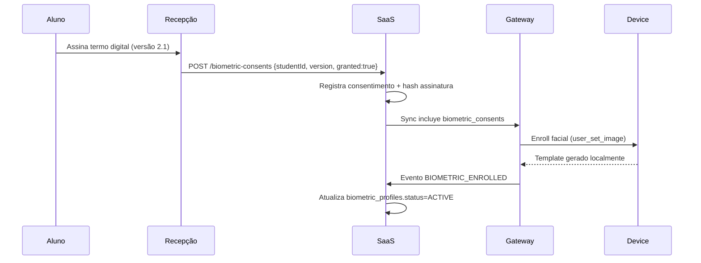

# Documento de Segurança — Fase 1

## Princípios Gerais

- **Defense in Depth**: Camadas múltiplas (rede, aplicação, dados, dispositivo)
- **Zero Trust**: Nunca confiar implicitamente; verificar sempre
- **Least Privilege**: Acesso mínimo necessário por papel/contexto
- **Privacy by Design**: LGPD/GDPR desde a arquitetura
- **Auditability**: Rastro completo de decisões e acessos

---

## 1. Autenticação

### 1.1 Backend SaaS (Staff, Admin, Alunos Web)

| Aspecto | Implementação |
|---------|---------------|
| **Protocolo** | OAuth 2.1 + OIDC (Spring Authorization Server) |
| **Tokens** | JWT RS256 (access: 15min, refresh: 30d rotation) |
| **Password** | Argon2id (memory=64MB, iterations=3, parallelism=4) |
| **MFA** | TOTP (RFC 6238) opcional para staff; obrigatório para SAAS_ADMIN |
| **Session** | Stateless JWT; refresh token armazenado em DB (hash) + revogação |
| **Device Trust** | Fingerprinting + IP reputation para refresh token rotation |

### 1.2 Gateway ↔ SaaS

| Aspecto | Implementação |
|---------|---------------|
| **Transporte** | mTLS 1.3 (mutual authentication) |
| **Certificados** | PKI própria: Root CA → Intermediate → Gateway/Device certs |
| **Validade** | Gateway: 1 ano (renovação automática 30d antes); Device: 2 anos |
| **Revogação** | CRL + OCSP stapling; revogação imediata via API SaaS |
| **Bootstrap** | CSR gerado no gateway → SaaS assina → certificado instalado |

### 1.3 Gateway ↔ Dispositivos Control iD

| Aspecto | Implementação |
|---------|---------------|
| **Autenticação** | User/password por device (configurado no provisionamento) |
| **Armazenamento** | `device_credentials.password_hash` = Argon2id |
| **Rotação** | A cada 90 dias via job agendado + notificação SaaS |
| **Rede** | VLAN isolada (10.x.x.x/24); firewall: gateway → device only |

### 1.4 Alunos (App Mobile / Portal)

| Aspecto | Implementação |
|---------|---------------|
| **Auth** | Same OAuth 2.1 + PKCE (public client) |
| **Biometria App** | FaceID / TouchID / BiometricPrompt (local only, não sobe servidor) |
| **Sessão** | Refresh token rotation + device binding |

---

## 2. Autorização (RBAC + ABAC)

### 2.1 Matriz de Roles

| Role | Escopo | Permissões Principais |
|------|--------|----------------------|
| `SAAS_ADMIN` | Global | Tenant CRUD, Planos SaaS, Auditoria global, Gateway mgmt |
| `TENANT_ADMIN` | Tenant | Branches, Users, Planos academia, Relatórios financeiros |
| `BRANCH_MANAGER` | Branch | Students, Staff, Access Rules, Devices, Relatórios unidade |
| `RECEPTIONIST` | Branch | Student CRUD, Check-in, Biometric enroll, Pagamentos |
| `TRAINER` | Branch | Student read, Treinos, Avaliações |
| `STUDENT` | Próprio | Perfil, Agenda, Treinos, Status plano, Histórico acesso |

### 2.2 Permissões (Granulares)

Formato: `{resource}:{action}` — ex: `student:create`, `access_rule:delete`, `device:reboot`

| Resource | Actions |
|----------|---------|
| `tenant` | create, read, update, delete, manage_subscription |
| `branch` | create, read, update, delete, manage_devices |
| `user` | create, read, update, delete, assign_role, reset_mfa |
| `student` | create, read, update, delete, enroll_biometric, checkin, block |
| `plan` | create, read, update, delete, assign |
| `payment` | create, read, refund, export |
| `access_rule` | create, read, update, delete, test |
| `device` | read, reboot, configure, firmware_update, enroll |
| `gateway` | read, restart, certificate_rotate |
| `audit_log` | read, export |
| `report` | read, export |

### 2.3 Políticas ABAC (Contextuais)

```java
// Exemplo: Recepção só acessa alunos da própria branch
@PreAuthorize("hasPermission(#studentId, 'student:read') " +
              "and @branchSecurity.isUserInBranch(authentication, #studentId)")

// Exemplo: Admin SaaS vê tudo, mas não edita dados de tenant ativo sem justificativa
@PreAuthorize("hasRole('SAAS_ADMIN') and @audit.requireJustification('tenant:update')")
```

### 2.4 Isolamento Multi-Tenant (Enforcement)

```java
// 1. JPA/Hibernate Filter (automático em todas queries)
@FilterDef(name = "tenantFilter", parameters = @ParamDef(name = "tenantId", type = "uuid"))
@Filter(name = "tenantFilter", condition = "tenant_id = :tenantId")
@Entity
public class Student { ... }

// 2. TenantContextHolder (Request-scoped)
@Component
public class TenantContextHolder {
    private static final ThreadLocal<UUID> CONTEXT = new ThreadLocal<>();
    // + ContextPropagator para WebFlux/async
}

// 3. RLS PostgreSQL (Defesa em profundidade)
CREATE POLICY tenant_isolation ON students
  USING (tenant_id = current_setting('app.current_tenant')::uuid);

// 4. Validação em Controllers
@GetMapping("/students/{id}")
public Student get(@PathVariable UUID id) {
    // Verifica se student.tenant_id == currentTenantId()
    return studentService.findByIdAndTenant(id, currentTenantId());
}
```

---

## 3. Criptografia

### 3.1 Em Trânsito

| Fluxo | Protocolo | Cipher Suites |
|-------|-----------|---------------|
| Client ↔ SaaS | TLS 1.3 | TLS_AES_256_GCM_SHA384, TLS_CHACHA20_POLY1305_SHA256 |
| SaaS ↔ Gateway | mTLS 1.3 | Same + client cert verification |
| Gateway ↔ Device | HTTPS (TLS 1.2+) | Device limitation; prefer TLS 1.3 se suportado |
| SaaS ↔ DB | TLS 1.3 | PostgreSQL `sslmode=verify-full` |
| SaaS ↔ Redis | TLS 1.3 | `rediss://` |
| SaaS ↔ Message Broker | TLS 1.3 | AMQPS / Kafka SSL |

### 3.2 Em Repouso

| Dado | Algoritmo | Gestão de Chaves |
|------|-----------|------------------|
| Passwords (users, devices) | Argon2id | N/A (hash) |
| Biometric templates (DB) | AES-256-GCM | DEK por tenant + KEK no HSM/KMS (AWS KMS, HashiCorp Vault) |
| Fotos faciais (storage) | AES-256-GCM | Same |
| Gateway SQLite | SQLCipher (AES-256) | Chave derivada de certificado gateway + PIN |
| Audit logs | AES-256-GCM (campos sensíveis) | KEK rotation anual |
| Backups | AES-256-GCM | Chave separada, armazenada no KMS |

### 3.3 Chaves e Segredos

- **Nunca** em código, config files, variáveis de ambiente (exceto dev)
- **Produção**: HashiCorp Vault / AWS Secrets Manager / Azure Key Vault
- **Rotação**: Automática (90 dias para segredos, 1 ano para chaves de criptografia)
- **Acesso**: Princípio de menor privilégio; apps leem via sidecar/CSI driver

---

## 4. Segurança Biométrica

### 4.1 Princípios LGPD (Art. 5º, 11, 12)

| Princípio | Implementação |
|-----------|---------------|
| **Finalidade** | Apenas controle de acesso + frequência (consentimento explícito) |
| **Adequação** | Template facial (não foto) no device; foto opcional, criptografada |
| **Necessidade** | Coleta mínima: 1 foto → template; descarte foto se `keep_user_image=0` |
| **Livre Acesso** | Portal aluno: ver status, solicitar exclusão |
| **Qualidade** | Validação qualidade no enrolment (scores Control iD) |
| **Transparência** | Termo de consentimento versionado (`biometric_consents`) |
| **Segurança** | Criptografia em repouso + trânsito; acesso restrito |
| **Prevenção** | Liveness detection obrigatório; threshold rigoroso |
| **Não Discriminação** | Fallback: cartão/PIN para quem não consentir |
| **Responsabilização** | Auditoria completa + DPO nomeado |

### 4.2 Fluxo de Consentimento



### 4.3 Revogação (Direito ao Esquecimento)

```java
@Transactional
public void revokeBiometricConsent(UUID studentId, String reason) {
    // 1. Marcar consentimento revoked_at = now()
    // 2. biometric_profiles.status = REVOKED
    // 3. Enviar comando gateway: destroy_objects (face_templates) + user_destroy_image
    // 4. Gateway executa em todos devices do tenant
    // 5. Confirmar exclusão → biometric_enrollments.sync_status = REVOKED
    // 6. Audit log: BIOMETRIC_REVOKED (risk_level=HIGH)
    // 7. Notificar aluno (email/push)
}
```

### 4.4 Proteção de Templates

- **Nunca** armazenar template facial bruto no SaaS (apenas hash SHA-256 para dedup)
- **Device** gera e armazena template; SaaS envia apenas foto (criptografada)
- **Gateway** não persiste fotos; apenas faz proxy stream
- **Backup** de templates: não incluído (regenerável a partir de foto se consentimento ativo)

---

## 5. LGPD / Conformidade

### 5.1 Mapeamento de Dados Pessoais

| Categoria | Tabelas | Base Legal | Retenção |
|-----------|---------|------------|----------|
| Identificação | `students`, `users` | Contrato / Legítimo | Vigência + 5 anos |
| Biométrico | `biometric_profiles`, `enrollments`, `consents` | Consentimento (Art. 7º, 11) | Enquanto consentimento ativo |
| Financeiro | `payments`, `student_plans` | Contrato / Obrigação legal | 10 anos (fiscal) |
| Acesso | `access_logs` | Legítimo interesse (segurança) | Plano SaaS (90d/1y/5y) |
| Auditoria | `audit_logs` | Obrigação legal / Legítimo | 5 anos (LGPD Art. 37) |
| Contato | `students.email/phone`, `users.email` | Contrato / Consentimento | Vigência + 2 anos |

### 5.2 Direitos do Titular (Automatizados)

| Direito | Endpoint | SLA |
|---------|----------|-----|
| Confirmação/ Acesso | `GET /lgpd/my-data` | 15 dias |
| Correção | `PATCH /students/{id}` (self) | Imediato |
| Anonimização/ Bloqueio | `POST /lgpd/anonymize` | 15 dias |
| Portabilidade | `GET /lgpd/export` (JSON) | 15 dias |
| Eliminação | `POST /lgpd/delete` | 15 dias |
| Revogação Consentimento | `POST /biometric-consents/{id}/revoke` | Imediato |
| Oposição | `POST /lgpd/opt-out` | Imediato |

### 5.3 DPO e Governança

- **DPO**: Nomeado, contato público no rodapé
- **RIPD**: Relatório de Impacto para biométrico (Art. 38)
- **Registro de Operações**: `audit_logs` cobre Art. 37
- **Vazamento**: Plano de resposta < 72h (ANPD)

---

## 6. Proteção de Credenciais de Dispositivos

### 6.1 Armazenamento

```java
@Entity
@Table(name = "device_credentials")
public class DeviceCredential {
    @Id UUID id;
    @Column(nullable = false) UUID gatewayId;
    @Column(nullable = false) UUID deviceId;
    @Column(nullable = false, length = 50) String username; // "admin"
    @Column(nullable = false, length = 255) String passwordHash; // Argon2id
    @Column(length = 100) String apiKeyHash; // Se aplicável
    @Column(nullable = false) boolean active;
    @Column Instant rotatedAt;
}
```

### 6.2 Rotação Automatizada

```java
@Scheduled(cron = "0 0 3 * * SUN") // Domingos 3h
public void rotateDeviceCredentials() {
    for (DeviceCredential cred : activeCredentials) {
        if (Duration.between(cred.getRotatedAt(), Instant.now()).toDays() >= 90) {
            String newPassword = generateSecurePassword(32);
            // 1. Alterar no device via API (change_login.fcgi)
            // 2. Se sucesso: atualizar passwordHash no DB
            // 3. Registrar auditoria: CREDENTIAL_ROTATED
            // 4. Notificar SaaS para sync
        }
    }
}
```

### 6.3 Acesso Runtime

- Gateway descriptografa `passwordHash` → verifica → usa na sessão
- Chave de derivação: `PBKDF2(gateway_master_key, device_serial, 100000)`
- `gateway_master_key` no HSM/KMS; nunca em disco

---

## 7. Segurança da Comunicação SaaS ↔ Gateway

### 7.1 mTLS + JWT Híbrido

```mermaid
sequenceDiagram
    participant GW
    participant SaaS
    
    GW->>SaaS: HTTPS mTLS (cert cliente validado)
    SaaS->>GW: 200 + Set-Cookie: __Host-gw_session=JWT; Secure; HttpOnly; SameSite=Strict
    GW->>SaaS: Requests com Cookie + Header: X-Gateway-ID
    SaaS->>SaaS: Valida cert + JWT + gateway_id match
    SaaS->>GW: 401 se cert revogado ou JWT expirado
    GW->>SaaS: POST /auth/refresh (mTLS) → novo JWT
```

### 7.2 WebSocket para Comandos Imediatos

- Upgrade sobre mesma conexão mTLS
- Heartbeat ping/pong 30s
- Reconexão exponencial (1s, 2s, 4s, 8s, max 60s)
- Mensagens assinadas (HMAC-SHA256 com segredo compartilhado)

---

## 8. Auditoria e Detecção de Anomalias

### 8.1 Eventos Auditados (Risk Level)

| Ação | Risk | Detalhes |
|------|------|----------|
| Login SAAS_ADMIN | HIGH | IP, device, MFA |
| Tenant CRUD | HIGH | Before/after values |
| Biometric enroll/revoke | CRITICAL | Student, device, consent version |
| Credential rotation | MEDIUM | Device, success/fail |
| Access rule change | HIGH | Rule diff, branch |
| Gateway certificate rotate | HIGH | Old/new expiry |
| Bulk student export | HIGH | Count, filters, actor |
| Failed login (5+) | MEDIUM | IP, user, lockout |
| Device firmware update | MEDIUM | Version, status |
| Offline gateway > 1h | MEDIUM | Last seen, queue size |

### 8.2 Alertas Automáticos

```yaml
alerts:
  - name: "Gateway Offline"
    condition: "gateway_up == 0 for 5m"
    severity: "warning"
    channels: ["slack", "email", "pagerduty"]
  
  - name: "Biometric Revoked Without Consent"
    condition: "audit_log.action == 'BIOMETRIC_REVOKED' and not exists consent_revoked"
    severity: "critical"
    channels: ["pagerduty", "security-team"]
  
  - name: "Mass Access Denied"
    condition: "rate(access_logs{event='DENIED'}[5m]) > 100"
    severity: "warning"
    channels: ["slack"]
  
  - name: "Certificate Expiring"
    condition: "certificate_expiry_days < 30"
    severity: "warning"
    channels: ["email", "slack"]
```

---

## 9. Hardening Checklist

### 9.1 Aplicação (Spring Boot)

- [ ] `server.ssl.enabled=true` + TLS 1.3 only
- [ ] `spring.security.headers.content-security-policy` restritivo
- [ ] `server.error.include-stacktrace=never`
- [ ] Actuator endpoints: apenas `health`, `info`, `metrics` expostos; auth required
- [ ] Rate limiting: `Bucket4j` (100 req/min/IP auth, 1000 req/min/IP anon)
- [ ] Input validation: `@Valid` + custom validators; sanitização HTML
- [ ] SQL Injection: JPA/Querydsl only; zero raw SQL
- [ ] Deserialização: Jackson `FAIL_ON_UNKNOWN_PROPERTIES=false`, `DEFAULT_TYPING=NON_FINAL`
- [ ] Dependencies: `OWASP Dependency Check` no CI; `Spring Boot BOM`

### 9.2 Banco de Dados

- [ ] `sslmode=verify-full` + CA cert
- [ ] Usuário app com `GRANT SELECT, INSERT, UPDATE, DELETE` apenas; sem DDL
- [ ] RLS enabled em todas tabelas multi-tenant
- [ ] `audit_logs` append-only (trigger `BEFORE UPDATE/DELETE` → raise exception)
- [ ] Backup criptografado + teste restore mensal
- [ ] `pgcrypto` para campos sensíveis; chaves no Vault

### 9.3 Gateway

- [ ] Imagem Docker assinada (cosign/sigstore)
- [ ] `read-only` root filesystem; volumes apenas `/data`, `/certs`
- [ ] `capabilities: drop: [ALL]`; `security_opt: no-new-privileges:true`
- [ ] Firewall: apenas portas 8080 (monitor), 8081 (health), 443 (saas)
- [ ] SSH desabilitado; acesso via serial/console apenas
- [ ] Watchdog hardware (systemd watchdog + GPIO)
- [ ] Logs: journald + forward para SaaS (syslog TLS)

### 9.4 Rede

- [ ] VLANs: `mgmt`, `devices`, `gateways`, `saas` (isoladas)
- [ ] Firewall: `gateways → devices` (portas 80/443); `gateways → saas` (443)
- [ ] mTLS em todas conexões inter-serviço
- [ ] DNS interno (CoreDNS) + DNSSEC
- [ ] WAF/IDS na borda (Cloudflare/ModSecurity)

---

## 10. Riscos de Segurança Residuais

| Risco | Prob. | Impacto | Status | Plano |
|-------|-------|---------|--------|-------|
| Vulnerabilidade zero-day Spring/Log4j | Baixa | Crítico | Monitorado | Dependabot + Snyk + patch < 24h |
| Insider threat (DBA acessa biométrico) | Baixa | Alto | Mitigado | RLS + criptografia + auditoria imutável + separação de duties |
| Device fisicamente comprometido | Média | Alto | Parcial | Secure boot + TPM + alerta violação chassis |
| Replay attack (eventos Monitor) | Baixa | Médio | Mitigado | Nonce + timestamp + idempotency key |
| Side-channel (timing) em auth | Muito baixa | Baixo | Aceito | Constant-time comparison (Argon2id) |
| Supply chain (imagem base Docker) | Baixa | Alto | Mitigado | Distroless/Chainguard images + SBOM + signature verification |

---

## 11. Checklist Validação Segurança Fase 1

- [ ] Threat Modeling (STRIDE) completado para todos componentes
- [ ] Penetration Test agendado (caixa preta + caixa cinza)
- [ ] Certificados mTLS gerados (Root CA, Intermediate, templates)
- [ ] Vault/Secret Manager provisionado + políticas
- [ ] RLS policies testadas com 3 tenants simultâneos
- [ ] Biometric consent flow testado E2E (grant → enroll → revoke → delete)
- [ ] Credential rotation testada (device + gateway)
- [ ] Offline gateway scenario validado (7 dias, replay)
- [ ] Audit log imutabilidade verificada (tentativa UPDATE/DELETE falha)
- [ ] LGPD DSR (Data Subject Request) endpoints funcionais
- [ ] Backup/restore testado com criptografia
- [ ] Incident Response Plan documentado + tabletop exercise